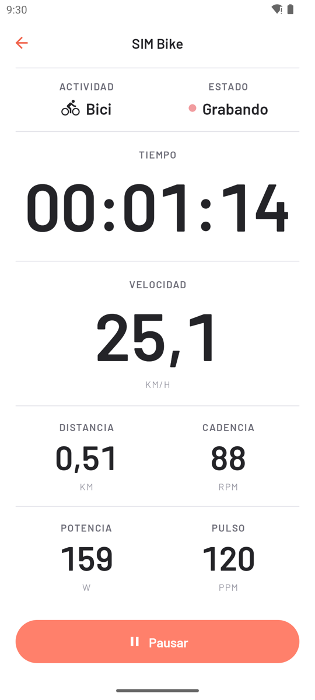

# SweatSync

Android app that reads your treadmill or indoor bike over Bluetooth and uploads the workout to **Garmin Connect** and/or **Strava**.

Many gym machines only talk to their own app. SweatSync connects directly to any machine that supports the standard **FTMS** Bluetooth profile, records the session, and sends it where you want it.

<p align="center">
  
</p>

## Install

1. On your Android phone (Android 10 or newer), download **[SweatSync.apk](https://github.com/jesus-sayar/sweatsync/releases/latest/download/SweatSync.apk)**.
2. Open the downloaded file. If Android asks, allow your browser or Files app to **install unknown apps**.
3. Tap **Install**. If Play Protect warns that the developer is unknown, tap **More details → Install anyway**.
4. Open SweatSync, enter your weight and date of birth, and allow **Nearby devices** (Bluetooth) and notifications.

To update, install the new APK over the old one: your history and connections are kept.

## Features

- Lists nearby machines and pairs with the one you pick.
- Records the activity with **Start, Pause, Resume and Finish**.
- Live metrics, adapted to the machine:
  - **Treadmill**: time, distance, pace, speed.
  - **Bike**: time, distance, speed, plus cadence, power and heart rate when the bike reports them.
  - Every metric fits on one screen, without scrolling.
- Estimates the calories you burn from your weight.
- Keeps a local history of your activities, with a detail screen for each one.
- Link Garmin and Strava, and switch each one's sync on or off. When you finish, the activity is uploaded to every connected platform with sync on.
- Always saves the `.fit` file to your Downloads folder.
- Keeps recording with the screen off.
- English and Spanish.

## Screens

1. **Welcome** (first launch only): your weight and date of birth, needed to estimate calories.
2. **Home**: pick your treadmill or bike.
3. **Workout** (picture above): live metrics and the Start / Pause / Resume / Finish buttons. Before Start, the back arrow returns to Home; once started, back and Finish ask whether to save or discard the activity.
4. **Activities**: your history. Tap one for its detail (distance, duration, calories, average pace or speed).
5. **Settings**: personal data, and the Garmin and Strava connections. Tap a connected platform to turn its sync on or off, or disconnect it.

## Supported machines

Any treadmill or indoor bike that exposes the FTMS service (`0x1826`) with *Treadmill Data* (`0x2ACD`) or *Indoor Bike Data* (`0x2AD2`). Most "Zwift compatible" machines do.

Not sure about yours? Open a BLE scanner such as nRF Connect and look for service `0x1826`. Cheap machines that only work with their own app usually do not have it.

Machines that allow a single Bluetooth connection cannot be used while another app is connected to them.

## Requirements

- Android 10 (API 29) or newer, with Bluetooth LE.
- JDK 17 and the Android SDK (command-line tools are enough).

## Build and run

Set your SDK path in `local.properties` (it is machine-specific and not versioned):

```
sdk.dir=/path/to/android-sdk
```

Then, with a phone connected over USB or Wi-Fi debugging:

```
./run.sh
```

It builds, installs and opens the app. To only build or test:

```
./gradlew assembleDebug
./gradlew testDebugUnitTest
```

The APK is in `app/build/outputs/apk/debug/`.

### Without a phone: emulator and virtual machine

The Android emulator has a virtual Bluetooth radio, and `tools/ftms_simulator.py` puts a virtual FTMS treadmill or bike on it, so the whole flow (search, connect, record, history) can be tried on the computer:

```
tools/emulator.sh setup        # once: emulator + Python environment (Bumble)
tools/emulator.sh start        # boot the emulator
tools/emulator.sh install      # build and install the app with a test profile
tools/emulator.sh treadmill    # switch a virtual treadmill on (Ctrl+C switches it off)
tools/emulator.sh bike         # or a bike
tools/emulator.sh onboarding   # reinstall without profile to see the welcome screen
```

## License

MIT, see [`LICENSE`](LICENSE). The bundled fonts keep their own license (below).

## Credits

Fonts: Barlow (Regular to Black) and Barlow Condensed by The Barlow Project Authors, SIL Open Font License 1.1 (see `licenses/`).

## Important notes

- **Garmin and Strava uploads are unofficial.** They imitate the official app/website sign-in, so they can break whenever Garmin or Strava change something. Using them may go against each service's terms.
- Passwords are never stored. Garmin keeps a refresh token and Strava keeps your session cookies, both in the app's private storage.
- If an upload fails, the `.fit` file is still in Downloads and can be imported manually on the Garmin or Strava website.
- Strava sign-in uses Strava's own page inside the app. "Continue with Google" may be blocked there; use email and password.

## Roadmap

- Rowers and ellipticals.
- Charts and totals for the history.
